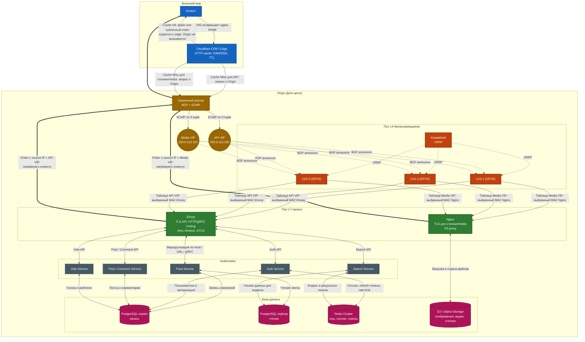
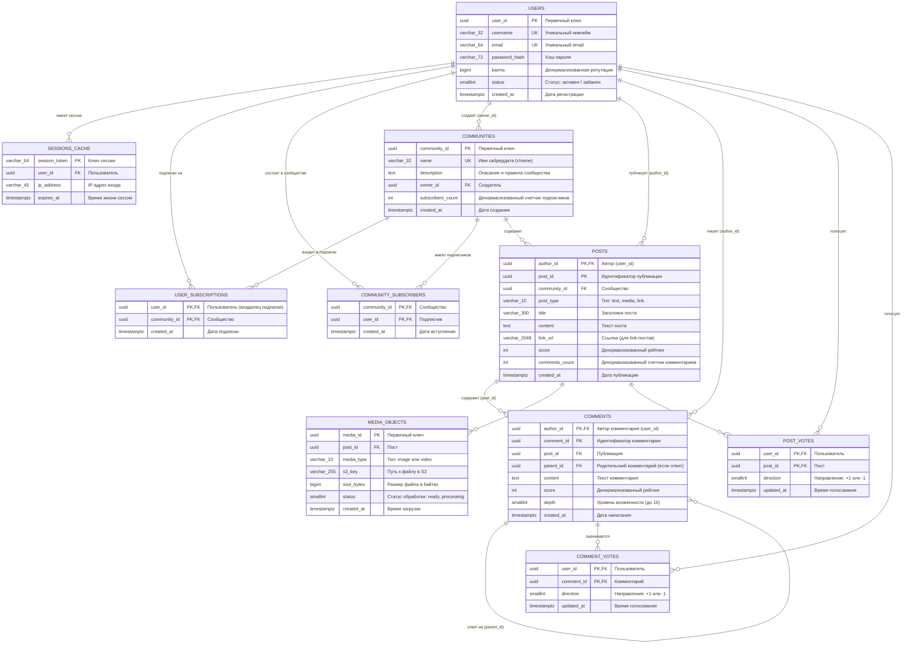

# Расчётно-пояснительная записка

**Дисциплина:** Проектирование высоконагруженных систем  
**Тема проекта:** Проектирование бэкенда высоконагруженного сервиса агрегации новостей и обсуждений (на примере «Reddit»)

---

## Оглавление

1. [Тема и целевая аудитория](#1-тема-и-целевая-аудитория)
2. [Расчет нагрузки](#2-расчет-нагрузки)
3. [Глобальная балансировка нагрузки](#3-глобальная-балансировка-нагрузки)
4. [Локальная балансировка нагрузки](#4-Локальная-балансировка-нагрузки)
5. [Логическая схема БД](#5-Логическая-схема-БД)
6. [Список источников](#список-источников)
   
---

## 1. Тема и целевая аудитория

### 1.1 Тип сервиса, рыночная ниша и аналоги
**Выбранная тема:** проектирование бэкенда сервиса агрегации пользовательского контента, модерации и дискуссий.  
**Реальные аналоги:** Reddit, Pikabu, Hacker News.  
Рынок сформирован. Основная ценность формируется за счет сетевого эффекта и пользовательского контента (UGC).

### 1.2 Целевая аудитория: размер и локализация
Массовый конечный пользователь (B2C). Опираемся на **официальные данные Reddit Inc. на 30 июня 2026 года**:

| Метрика | Значение | Локализация / Период | Источник |
| :--- | :--- | :--- | :--- |
| **DAU (Daily Active Uniques)** | **130 000 000+** уникальных пользователей | Глобально, Q2 2026 | [Reddit Investor Relations](https://investor.redditinc.com) |
| **WAU (Weekly Active Uniques)** | **514 000 000+** уникальных пользователей | Глобально, Q2 2026 | [Reddit Investor Relations](https://investor.redditinc.com) |
| **Active Communities** | **100 000+** активных сообществ | Глобально, Q2 2026 | [Reddit Investor Relations](https://investor.redditinc.com) |
| **Posts & Comments** | **26 000 000 000+** публикаций и комментариев | Накоплено за всё время | [Reddit Investor Relations](https://investor.redditinc.com) |
| **MAU (оценка)** | **~1 300 000 000** уникальных посетителей | Глобально, 2026 | [Wiki Iphoster: Reddit обзор 2026](https://wiki.iphoster.net/wiki/Reddit_-_%D0%BE%D0%B1%D0%B7%D0%BE%D1%80_-_2026#.D0.A1.D1.82.D0.B0.D1.82.D0.B8.D1.81.D1.82.D0.B8.D0.BA.D0.B0_.282026.29) |

### 1.3 Продуктовые требования

Сервис должен:

1. Предоставлять пользователям единую ленту актуального пользовательского контента по интересующим их темам;
2. Обеспечивать разделение контента по тематическим сообществам и возможность подписки на них;
3. Позволять пользователям создавать публикации и участвовать в обсуждениях;
4. Обеспечивать коллективную оценку публикаций и комментариев;
5. Формировать персонализированную ленту на основе подписок, рейтинга и времени публикации;
6. Предоставлять быстрый поиск по публикациям и тематическим сообществам;
7. Поддерживать безопасную регистрацию и авторизацию пользователей.

### 1.4 Функционал MVP

Для проектирования выделены следующие 7 ключевых функций, покрывающих основной сценарий использования сервиса:

1. **Регистрация и авторизация пользователей.** Создание аккаунта и безопасный вход в систему;
2. **Создание и управление сообществами (сабреддитами).** Пользователи могут создавать новые тематические сообщества, настраивать их описание, правила и подписываться на них;
3. **Создание и публикация постов.** Пользователь создаёт текстовый пост, ссылку или медиафайл внутри конкретного сообщества;
4. **Голосование за контент (Upvote/Downvote).** Пользователи оценивают посты и комментарии стрелками вверх/вниз, формируя рейтинг и сортировку ленты;
5. **Комментирование с древовидной структурой.** Пользователи оставляют комментарии к постам и отвечают на другие комментарии с вложенностью до 10 уровней;
6. **Формирование персональной ленты.** Агрегация постов из подписанных сообществ с сортировкой по популярности (Hot) или времени публикации (New);
7. **Поиск по постам и сообществам.** Полнотекстовый поиск по заголовкам, тексту постов и названиям сабреддитов;

## 2. Расчет нагрузки

### 2.1 Аудиторные метрики

Базовые показатели аудитории опираются на официальную отчетность платформы.

| Метрика | Значение | Обоснование и источник |
|---|---|---|
| Месячная аудитория (MAU) | 1 300 000 000 | Оценочные данные по уникальным посетителям глобально [Источник 2]. |
| Дневная аудитория (DAU) | 130 000 000 | Официальный отчет Reddit Investor Relations (Q2 2026) [Источник 1]. |

### 2.2 Средний размер "хранилища" пользователя (в штуках и ГБ/МБ)

**Логика расчета:**

Контент пользователя — это его публикации (UGC). Чтобы посчитать размер хранилища одного пользователя, мы берем ежедневную генерацию контента платформы, делим на актуальный DAU (130 млн) и умножаем на 365 дней, получая средний годовой объем данных на одного человека.

- **Исходные данные:** В среднем в день создается 1,2 млн постов и 9,7 млн комментариев [Источник 4].
- **Пропорция постов** [Источник 3]: 38% — изображения, 29% — текст, 21% — видео, 12% — ссылки.
- **Генерация на 1 DAU в день:**
    - Комментарии: `9 700 000 / 130 000 000 = 0,0746` шт. в день.
    - Посты (все): `1 200 000 / 130 000 000 = 0,0092` шт. в день.

Применяем пропорции к постам и умножаем на 365 дней:

| Тип данных (на 1 пользователя за год) | Количество, шт. | Объем, МБ | Обоснование / Расчет |
|---|---|---|---|
| Комментарии | ~ 27,2 шт. | ~ 0,05 МБ | 0,0746 комментов/день × 365. Вес одного текста с метаданными принимаем за ~2 КБ. |
| Текстовые посты | ~ 1,0 шт. | ~ 0,002 МБ | 0,0092 постов × 29% × 365. Вес принимаем за ~2 КБ. |
| Посты со ссылками | ~ 0,4 шт. | ~ 0,001 МБ | 0,0092 постов × 12% × 365. Вес ссылки с метаданными ~2 КБ. |
| Изображения | ~ 1,3 шт. | ~ 6,5 МБ | 0,0092 постов × 38% × 365. В [Источнике 3] указано ограничение 20 МБ, но оптимальный вес до 10 МБ. Для расчета берем среднее значение 5 МБ на фото. |
| Видео | ~ 0,7 шт. | ~ 14,0 МБ | 0,0092 постов × 21% × 365. Опираясь на вес фото, для видео консервативно закладываем в среднем 20 МБ на короткий ролик. |
| **Итоговый объем на пользователя (за год)** | **30,6 шт.** | **20,5 МБ** | Социальная сеть имеет крайне малый вес генерации данных на 1 пользователя, так как большинство только читает. |

### 2.3 Среднее количество действий пользователя в день

**Логика расчета:**

Все действия рассчитываются на 1 активного пользователя в день (DAU).

| Тип действия (Функционал MVP) | Действий в день (на 1 DAU) | Обоснование / Источник |
|---|---|---|
| Просмотр контента (скролл ленты / открытие постов) | 25 | В [Источнике 4] указано, что пользователи проводят на сайте 20-30 минут в день. Инженерное допущение: 1 запрос (подгрузка пачки постов или открытие комментариев) в 1 минуту активного времени. Итого ~25 действий за сессию. |
| Голосование (Оценка контента) | 2 | Прямой статистики в отчетах нет. Инженерное допущение (воронка вовлеченности): голосуют значительно чаще, чем пишут. Если пользователь пишет ~0,07 комментариев в день, логично предположить, что он ставит оценки (лайк/дизлайк) примерно в 20-30 раз чаще. Возьмем 2 голосования в день. |
| Создание комментария | 0,075 | 9 700 000 комментариев в день делим на 130 000 000 DAU [Источник 4]. |
| Создание поста | 0,009 | 1 200 000 постов в день делим на 130 000 000 DAU [Источник 4]. |
| Авторизация (Вход) | 1 | Стандартное количество сессий (открытий приложения) в день на 1 активного пользователя. |
| Поиск по постам и сообществам | 0,2 | Около 20% пользователей в день пользуются строкой поиска целенаправленно (поиск конкретного сабреддита или темы). |
| Создание сообщества (сабреддита) | 0,0001 | Редкое действие. Из 130 млн DAU в день создается не более 10-15 тысяч новых активных сообществ. |

## 2.4 Технические метрики

Для расчета технических метрик применяются следующие инженерные допущения:

- **Горизонт планирования (Capacity Planning):** Расчет дискового пространства производится на 1 год работы платформы (накопление свежего UGC-контента).
- **Технический оверхед хранения:**
  - *Текст и метаданные (БД):* Используется фактор репликации x3 (стандарт для надежных СУБД).
  - *Изображения (S3 Object Storage):* К оригиналу (5 МБ) добавляется +20% дискового пространства на генерацию миниатюр (превью) для разных платформ. Итого: 6 МБ на файл.
  - *Видео (S3 Object Storage):* Оригинал (20 МБ) оптимизируется и конвертируется в разные разрешения (1080p, 720p, 480p). Это увеличивает занимаемое место на диске в 2 раза. Итого: 40 МБ на файл.
- **Оценка Read-трафика (Egress):** При 1 действии «Просмотр ленты» скачивается ~1,5 МБ трафика на пользователя (JSON-файл ленты + автоматическая подгрузка превью изображений + буферизация начального чанка видео).
- **Пиковый коэффициент ($K_{peak}$):** Для расчета пикового сетевого трафика и RPS применяется стандартный коэффициент 2.0 (двукратное превышение пиковой нагрузки над среднесекундной).

### 2.4.1 Размер хранения в разбивке по типам данных (за 1 год)

Расчет базируется на общей суточной генерации контента всей платформой (1,2 млн постов и 9,7 млн комментариев), умноженной на 365 дней с учетом технического оверхеда.

| Тип данных (Блок) | Количество элементов в год, шт. | Объем на диске, ТБ | Обоснование / Расчет |
|---|---|---|---|
| Текст и метаданные (СУБД) | ~ 3,72 млрд | ~ 22 ТБ | (3,54 млрд комментов + 179 млн текстовых/ссылочных постов). Вес 2 КБ × 3 (репликация). |
| Изображения (Object Storage) | ~ 166,4 млн | ~ 998 ТБ | 38% от 438 млн постов в год. 166,4 млн × 6 МБ (с учетом превью) / 1000 / 1000. |
| Видео (Object Storage) | ~ 92,0 млн | ~ 3 680 ТБ | 21% от 438 млн постов в год. 92 млн × 40 МБ (с учетом конвертации HLS) / 1000 / 1024. |
| **Итого за 1 год** | **3,97 млрд** | **4 700 ТБ (4,7 ПБ)** | Дисковая квота, необходимая дата-центру для хранения 1 года активности. |

### 2.4.2 Сетевой трафик

Разбивка трафика по основным бизнес-процессам (Ingress — загрузка контента пользователями на сервер, Egress — отдача контента пользователям).

| Направление / Тип трафика | Суммарный суточный, ГБ/сутки | Пиковое потребление, Гбит/с | Обоснование / Расчет (в сутки) |
|---|---|---|---|
| Ingress: Загрузка изображений | ~ 2 280 | 0,42 | ~455 тыс. фото/день × 5 МБ (оригинал). |
| Ingress: Загрузка видео | ~ 5 041 | 0,93 | ~252 тыс. видео/день × 20 МБ (оригинал). |
| Ingress: Текстовые данные | ~ 50 | 0,01 | Комментарии, посты, оценки. Трафиком можно пренебречь. |
| Egress: Чтение ленты и контента | ~ 4 875 000 | 902,7 | 130 млн DAU × 25 скроллов ленты × 1,5 МБ (медиа + JSON). Подавляющая часть (95%+) будет терминироваться на CDN. |
| **Итого** | **4 882 371 (~4,8 ПБ)** | **904 Гбит/с** | Ярко выраженный профиль Read-Heavy системы. |

> **Формула пикового трафика (Гбит/с):** `(ГБ_в_сутки × 8) / 86400 секунд × 2.0 (K_peak)`
> *Пояснение:* 1 Байт = 8 бит. Умножаем ГБ на 8, получая Гбит. Делим на количество секунд в сутках, получая среднюю скорость в Гбит/с. Умножаем на коэффициент пика (2.0). 

### 2.4.3 RPS (Requests Per Second) в разбивке по типам запросов

Для расчета используются действия на 1 DAU (из п. 2.3), умноженные на общую дневную аудиторию (130 млн) и разделенные на количество секунд в сутках (86 400).

| Тип запроса (по методам MVP) | Средний RPS | Пиковый RPS |
|---|---|---|
| GET /feed (Формирование ленты и просмотр тредов) | 37 615 | 75 230 |
| POST /vote (Голосование Upvote/Downvote) | 3 009 | 6 018 |
| POST /auth (Авторизация пользователя) | 1 504 | 3 008 |
| GET /search (Поиск) | 301 | 602 |
| POST /comment (Создание комментария) | 112 | 224 |
| POST /post (Создание поста) | 13 | 26 |
| POST /subreddit (Создание сообщества) | 0,15 | 0,3 |
| **Итого API RPS (к бэкенду)** | **42 554** | **85 108** |

## 3. Глобальная балансировка нагрузки

### 3.1 Функциональное разбиение по доменам

Инфраструктура разделена на три домена под разные типы нагрузки. Для всех доменов единой точкой входа является **BGP Anycast (Cloudflare CDN)**:

| Домен | Тип трафика | Способ балансировки | Куда направляется трафик |
| :--- | :--- | :--- | :--- |
| **`www.reddit.com`** | Веб-статика (HTML, JS, CSS) | Anycast (Cloudflare CDN) | 99% отдается из кэша CDN. При промахе — запрос к Origin в ДЦ. |
| **`api.reddit.com`** | Динамика (лента, посты, комменты, голоса, вход) | Anycast (Cloudflare) | Запросы не кэшируются и проксируются напрямую в единственный Origin ДЦ. |
| **`media.reddit.com`** | Медиа (фото, видео) | Anycast (Cloudflare CDN) | 80% отдается из кэша CDN. При промахе кэша (20%) запрашивается из хранилища в ДЦ. |

#### Обоснование кэша 80/20 и использование Regional Tiered Cache:
* **Обоснование распределения 80/20:** По закону Ципфа распределение популярности контента в сети неравномерна, что на практике сводится к правилу Парето (80/20): около 20% популярных постов генерируют 80% всех просмотров и постоянно удерживаются в кэше CDN. Оставшиеся 20% запросов приходятся на редкие и архивные публикации, вызывая промах кэша (Cache Miss).
* **Regional Tiered Cache [6]:** для медиаданных включается иерархический кэш Cloudflare. При промахе кэша на локальном периферийном узле запрос идет не сразу в ДЦ, а в крупный региональный дата-центр Cloudflare (Upper Tier). Только если файл отсутствует и в региональном кэше, запрос уходит в Origin ДЦ. Это исключает лишние трансатлантические запросы и защищает единственный ДЦ от резких всплесков обращений за тяжелыми файлами.

#### Путь запроса для каждого домена:
* **`www.reddit.com`:** Клиент $\rightarrow$ ближайший узел Anycast (Cloudflare) $\rightarrow$ отдача статики из кэша.
* **`api.reddit.com`:** Клиент $\rightarrow$ ближайший узел Anycast (Cloudflare) $\rightarrow$ проксирование напрямую в Origin ДЦ (Северная Вирджиния).
* **`media.reddit.com`:** Клиент $\rightarrow$ ближайший узел Anycast (Cloudflare). При попадании в кэш (80%) отдается сразу, при промахе (20%) $\rightarrow$ проверка в Regional Tiered Cache $\rightarrow$ при отсутствии файла запрос в S3 Origin ДЦ.

---

### 3.2 Обоснование расположения ДЦ

Более 55% активной аудитории сервиса сосредоточено в Северной Америке (США — 48,69%, Канада — 6,97% [5]), поэтому единственный дата-центр размещается в **Северной Вирджинии (US-East)**, что дает минимальный пинг ключевой части пользователей и не требует сложной межрегиональной синхронизации БД.

---

### 3.3 Расчет распределения запросов по дц

Так как дата-центр один, он принимает 100% динамических запросов и 20% промахов кэша медиа.

#### Таблица 1. Распределение API-запросов к единственному ДЦ (Северная Вирджиния)

| Тип запроса | Доля от всех запросов, % | Пиковая нагрузка на ДЦ, RPS |
| :--- | :--- | :--- |
| `GET /feed` (Лента и треды) | 88,4% | 75 230 |
| `POST /vote` (Голосование) | 7,1% | 6 018 |
| `POST /auth` (Авторизация) | 3,5% | 3 008 |
| `GET /search` (Поиск) | 0,7% | 602 |
| `POST /comment` (Комментарии) | 0,26% | 224 |
| `POST /post` (Создание поста) | 0,03% | 26 |
| `POST /subreddit` (Создание сообщества) | < 0,01% | 0,3 |
| **ИТОГО** | **100%** | **85 108** |

#### Таблица 2. Распределение сетевой нагрузки медиа (Egress)

| Направление трафика | Доля, % | Пиковая пропускная способность | Куда приходится нагрузка |
| :--- | :--- | :--- | :--- |
| **Edge Cache Hit** | 80% | 723,2 Гбит/с | Поглощается сетью CDN |
| **Origin Cache Miss** | 20% | 180,8 Гбит/с | Приходит в ДЦ |

---

### 3.4 Схема Anycast-балансировки

Глобальная балансировка построена на **BGP Anycast** через Cloudflare:
1. **Принцип работы:** Один и тот же IP-адрес анонсируется по протоколу BGP сразу из сотен точек присутствия по всему миру. Маршрутизаторы интернет-провайдеров направляют трафик пользователя по кратчайшему сетевому пути к ближайшей точке CDN.
2. **Обоснование выбора:** Использование инфраструктуры Cloudflare позволяет получить Anycast без аренды собственной Автономной Системы (AS) и подсети `/24`, а также закрывает инфраструктуру от DDoS-атак на периферии. Использование Regional Tiered Cache [6] дополнительно агрегирует промахи кэша внутри макрорегионов, минимизируя нагрузку на входящий канал ДЦ.

## 4. Локальная балансировка нагрузки



## Балансировка и резервирование

| Уровень | Балансировка | Резерв в одном ДЦ |
|---|---|---|
| Сеть | Два граничных роутера и два коммутатора; ECMP распределяет соединения | Второй роутер/коммутатор сохраняет сетевой путь при отказе первого |
| L4 | LVS выбирает Envoy или Nginx; BGP/health check исключают отказавший узел | `N+1`: рабочие LVS плюс один резервный |
| L7 API | Envoy завершает TLS и распределяет запросы по Kubernetes-сервисам | `N+1`: рабочие Envoy плюс один резервный |
| L7 media | Nginx проксирует media-запросы к S3/Object Storage | `N+1`: рабочие Nginx плюс один резервный |

`N+1` применяется внутри этого ДЦ: N узлов нужны для расчётного пика, ещё один переживает отказ узла. `N×2` здесь не применяется: второй ДЦ в архитектуре не предусмотрен.

## Расчёт количества узлов

**85 108 API RPS** и **904 Гбит/с media egress**. Для запаса используем коэффициент **1,3**. Принятые мощности узлов: Envoy — **40 000 RPS**, Nginx — **20 Гбит/с**. Это проектные допущения; фактические мощности нужно подтвердить тестированием.

### Envoy и LVS для API

```text
API пик с запасом = 85 108 × 1,3 = 110 640 RPS
Envoy рабочих = ceil(110 640 / 40 000) = 3
Envoy с N+1 = 3 + 1 = 4
```

Средний API-ответ принят за 5 КБ. С учётом запаса API-трафик составляет около **4,43 Гбит/с**. При интерфейсе LVS 10 Гбит/с достаточно одного рабочего LVS; ещё один нужен для резерва: **2 LVS всего**. Media-ответы LVS не ограничивают, так как Direct Routing отправляет их напрямую от Nginx.


### Nginx для media

Весь media-пик может прийти из CDN в Origin.

```text
Media пик с запасом = 904 × 1,3 = 1 175,2 Гбит/с
Nginx рабочих = ceil(1 175,2 / 20) = 59
Nginx с N+1 = 59 + 1 = 60
```

Если CDN Cache Miss равен 10%, Origin получит около 117,5 Гбит/с с запасом: `ceil(117,5 / 20) + 1 = 7 Nginx`.

### Итог для одного Origin ДЦ

| Пул | Количество | Основание |
|---|---:|---|
| Граничные роутеры | 2 | Резервирование сети |
| L4 LVS | **2** | 1 рабочий по API-сети + 1 резерв (`N+1`) |
| Envoy | **4** | 3 узла покрывают 110 640 RPS + 1 резерв (`N+1`) |
| Nginx при Cache Miss 100% | **60** | 59 узлов по 20 Гбит/с + 1 резерв (`N+1`) |
| Nginx при Cache Miss 10% | **7** | 6 узлов по 20 Гбит/с + 1 резерв (`N+1`) |

Число Nginx выбирается по фактическому Cache Miss Cloudflare. Для любого пула расчёт: `N = ceil(пиковая нагрузка / производительность узла)`, затем для одного ДЦ добавляется один узел: `N+1`.

## 5. Логическая схема БД




### Описание таблиц

| Таблица | Назначение | Основные поля и связи |
|---|---|---|
| `USERS` | Учётные записи пользователей | `user_id` — PK; `username` и `email` уникальны; `password_hash` хранит хэш пароля; `karma` — текущая репутация; `status` — состояние аккаунта; `created_at` — дата регистрации. Связан Описание таблица с публикациями, комментариями, сообществами, подписками, голосами и сессиями. |
| `COMMUNITIES` | Тематические сообщества (сабреддиты) | `community_id` — PK; `name` уникально; `description` — описание и правила; `owner_id` — создавший сообщество пользователь; `subscribers_count` — денормализованный счётчик подписчиков; `created_at` — дата создания. Связана с создателем, аудиторией и публикациями. |
| `USER_SUBSCRIPTIONS` | Подписки конкретного пользователя | Составной PK (`user_id`, `community_id`); оба поля — FK; `created_at` — дата подписки. Используется для мгновенной выборки сабреддитов пользователя при формировании персонализированной ленты. |
| `COMMUNITY_SUBSCRIBERS` | Список участников сообщества | Составной PK (`community_id`, `user_id`); оба поля — FK; `created_at` — дата вступления. Обеспечивает мгновенный доступ к аудитории сабреддита по ключу сообщества. |
| `POSTS` | Публикации в сообществах | Составной PK (`author_id`, `post_id`), где `author_id` — FK на автора (`user_id`); `community_id` — FK на сабреддит; `post_type` — тип контента (text, media, link); `title`, `content` и `link_url` — тело поста; `score` и `comments_count` — денормализованные счётчики; `created_at` — дата публикации. |
| `COMMENTS` | Комментарии и ответы | Составной PK (`author_id`, `comment_id`), где `author_id` — FK на автора (`user_id`); `post_id` — FK на публикацию; `parent_id` — FK на родительский комментарий (вложенность до 10 уровней); `content` — текст; `score` — рейтинг; `depth` — уровень дерева; `created_at` — дата создания. Ключ по автору предотвращает Hot Key на запись в вирусных тредах и упрощает модерацию/бан спамеров. |
| `POST_VOTES` | Голоса за публикации | Составной PK (`user_id`, `post_id`), оба поля — FK; `direction` хранит `+1` или `-1`; `updated_at` — время последнего изменения голоса. Связывает пользователя с публикацией. |
| `COMMENT_VOTES` | Голоса за комментарии | Составной PK (`user_id`, `comment_id`), оба поля — FK; `direction` хранит `+1` или `-1`; `updated_at` — время последнего изменения голоса. Связывает пользователя с комментарием. |
| `MEDIA_OBJECTS` | Метаданные медиафайлов публикаций | `media_id` — PK; `post_id` — FK; `media_type` задаёт тип файла (image/video); `s3_key` указывает расположение объекта в S3; `size_bytes` — размер; `status` — состояние обработки (ready, processing); `created_at` — время загрузки. Сам бинарный файл хранится в Object Storage. |
| `SESSIONS_CACHE` | Данные сессий в Redis | `session_token` — PK и ключ сессии; `user_id` — FK на владельца; `ip_address` — IP входа; `expires_at` — срок действия сессии. Обеспечивает быстрый stateless-auth. |

### 1. Данные, файлы, кэши и буферы

| Категория | Количество за год | Объём за год | Хранение |
|---|---:|---:|---|
| Публикации и комментарии: текст и метаданные | ≈3,72 млрд объектов | ≈22 ТБ | Основная СУБД; расчёт выполнен с учётом 2 КБ на объект и трёх копий |
| Изображения с превью | ≈166,4 млн файлов | ≈998 ТБ | Object Storage; в среднем 6 МБ на файл |
| Видео с вариантами HLS | ≈92 млн файлов | ≈3 680 ТБ | Object Storage; в среднем 40 МБ на файл |
| **Всего постоянных данных за год** | **≈3,97 млрд объектов** | **≈4 700 ТБ (4,7 ПБ)** | Текст в СУБД, файлы в Object Storage |

### 2. Нагрузка на чтение и запись

| Операция | Средний RPS | Пиковый RPS | Направление |
|---|---:|---:|---|
| GET `/feed` — лента и просмотр тредов | 37 615 | 75 230 | Чтение |
| POST `/vote` — голосование | 3 009 | 6 018 | Запись |
| POST `/auth` — авторизация | 1 504 | 3 008 | Чтение и запись сессии |
| GET `/search` — поиск | 301 | 602 | Чтение |
| POST `/comment` — создание комментария | 112 | 224 | Запись |
| POST `/post` — создание публикации | 13 | 26 | Запись |
| POST `/subreddit` — создание сообщества | 0,15 | 0,3 | Запись |
| **Итого API** | **42 554** | **85 108** | — |


### 3. Требования к консистентности

| Объект или операция | Требование |
|---|---|
| `username`, `email` | Уникальность при конкурентной записи |
| Внешние ключи | Ссылки на существующие пользователя, сообщество, публикацию или комментарий |
| Подписка | Одна запись для пары `user_id`–`community_id` благодаря составному ключу |
| Голос | Одна актуальная запись для пары пользователь–публикация или пользователь–комментарий; допустимые значения `+1` и `-1` |
| Публикация и комментарий | Запись не должна подтверждаться до сохранения обязательных полей и связей |
| Сессия | Проверка срока действия `expires_at`; истёкшая сессия недействительна |
| Счётчики, кэш и поиск | Явный режим согласованности и допустимый лаг не заданы; это производные данные, источником остаются основные таблицы |

### 4. Распределение нагрузки по ключам

| Данные | Логический ключ | Особенность нагрузки |
|---|---|---|
| Пользователи | `user_id` | Запросы к пользователям распределяются по идентификатору; точные доли запросов по пользователям не приведены |
| Сообщества и публикации | `community_id` | Публикации одного сообщества обращаются к одной группе данных; для самых крупных сообществ отдельный объём запросов не приведён |
| Комментарии | `post_id`, `parent_id` | Комментарии одного поста читаются вместе с его деревом; отдельная статистика запросов к самым обсуждаемым постам не приведена |
| Подписки | `user_id`, `community_id` | Нужны оба направления доступа: подписки пользователя и подписчики сообщества |
| Голоса | `user_id` и идентификатор объекта | Составной ключ предотвращает повторную запись голоса; распределение голосов по объектам не задано |
| Сессии | `session_token` | Ключ Redis с TTL |
| Медиа | `media_id`, `post_id`, `s3_key` | Метаданные связаны с публикацией, файлы находятся в Object Storage |


### Формирование персонализированной ленты (`GET /feed`)

Это **самая высоконагруженная операция** платформы: на неё приходится **88,4% всех запросов** к бэкенду (**37 615 средний RPS** и **75 230 пиковый RPS**). 

#### Задействованные таблицы и их роль

* **`USER_SUBSCRIPTIONS`** — по ключу `user_id` отдаёт список сообществ (`community_id`), на которые подписан пользователь.
* **`POSTS`** — используется дважды: сначала для быстрого извлечения только идентификаторов (`post_id`) свежих постов сообществ, затем — для точечной вычитки полных текстов победивших публикаций.
* **`MEDIA_OBJECTS`** — отдаёт ссылки на изображения и видео для постов из финальной выдачи.

---

#### Как собирается лента

1. **Сбор кандидатов:**
   * Из таблицы `USER_SUBSCRIPTIONS` получаем список подписок пользователя (в среднем 30–50 `community_id`).
   * Из таблицы `POSTS` по этим сообществам запрашиваются только идентификаторы и даты свежих постов (`post_id`, `created_at`, `score`). 
   * Получаем пул из ~500–1000 легковесных ID в памяти сервиса.

2. **Ранжирование:**
   * Для отобранных кандидатов на CPU сервиса рассчитывается рейтинг по формуле **Reddit Hot**:
     
     $$\text{Score} = \log_{10}\big(\max(|U - D|, 1)\big) + \frac{\text{sign}(U - D) \cdot t}{45000}$$
     
   * **Параметры формулы:**
     * $U$ — апвоуты, $D$ — дизвоуты;
     * $t$ — время создания поста в секундах относительно точки отсчёта эпохи;
     * $45000$ — коэффициент затухания (12,5 часов);
     * $\text{sign}(U - D)$ — функция знака: возвращает $+1$ (если апвоутов больше), $-1$ (если дизвоутов больше) или $0$ (при равенстве);
     * Логарифм $\log_{10}$ реализует принцип *убывающей полезности голосов*. Первые 10 голосов дают такой же прирост рейтинга (+1 балл), как следующие 100 (+1 балл) и последующие 1000 (+1 балл). Это не позволяет вирусным постам с десятками тысяч лайков «вечно висеть» в топе.
   * Отсортировав массив по рейтингу в оперативной памяти, отсекаем **топ-25 лучших `post_id`**.

3. **Сборка контента:**
   * Только для 25 отобранных `post_id` из таблицы **`POSTS`** поднимаются полные данные (текст, ссылки, автор), а из **`MEDIA_OBJECTS`** — медиафайлы.
   * Формируется итоговый JSON (~5–8 КБ) и отдаётся клиенту.

## 6. Физическая схема БД

### 1. Виды нагрузки

| Вид | Данные и операции | Нагрузка |
|---|---|---:|
| **OLTP** | Пользователи, сообщества, подписки, посты, комментарии, голоса; транзакционные записи и чтение связей | `POST /vote` — 6 018 пиковых RPS; `POST /comment` — 224; `POST /post` — 26 |
| **Высоконагруженное чтение** | Формирование персональной ленты и чтение тредов | `GET /feed` — 75 230 пиковых RPS |
| **Key-Value / кэш** | Key-Value-хранилище: кэш ленты, refresh-токены, TTL и rate limit | `GET /feed` — 75 230 и `POST /auth` — 3 008 пиковых RPS |
| **Полнотекстовый поиск** | Индекс постов и сообществ, поиск по заголовку и тексту | `GET /search` — 602 пиковых RPS |
| **Object Storage** | Изображения, видео, превью и HLS-варианты | Около 4,7 ПБ за год |
| **Асинхронная обработка** | Обработка media и обновление поискового индекса | Фоновые операции, не должны блокировать OLTP |
| **Time-series и логирование** | Метрики API, БД, балансировщиков и восстановлений; логи | Вспомогательная нагрузка |


### 2. Характеристики нагрузки

- **Read/write:** система read-heavy; записи постов, комментариев и голосов требуют транзакций.
- **Консистентность:** пользователи, посты, комментарии и голоса должны записываться без потери данных. Поисковый индекс может обновляться позже.
- **Задержка:** лента и проверка refresh-токена требуют быстрого ответа.
- **Структура:** PostgreSQL — основные данные, Key-Value-хранилище — кэш ленты и refresh-токены, Object Storage — изображения и видео, индексы — для поиска по тексту постов и названиям сообществ.
### Запросы и индексы

Сначала фиксируем запросы, затем по ним выбираем индексы.

#### `GET /feed` — 75 230 пиковых RPS

Для каждого кандидата рассчитывается Reddit Hot:

$$\text{Score} = \log_{10}\big(\max(|U - D|, 1)\big) + \frac{\text{sign}(U - D) \cdot t}{45000}$$

`U` — апвоуты, `D` — дизвоуты, `t` — время создания поста в секундах относительно точки отсчёта эпохи. Коэффициент `45000` задаёт затухание по времени (12,5 часов), а `sign(U - D)` равен `+1`, `-1` или `0` в зависимости от перевеса голосов. Логарифм отражает убывающий прирост от новых голосов. Кандидаты сортируются по Score, затем берутся 25 лучших `post_id`.

```sql
-- подписки пользователя
SELECT community_id
FROM USER_SUBSCRIPTIONS
WHERE user_id = ...;

-- кандидаты для ранжирования
SELECT post_id, community_id, created_at, score
FROM POSTS
WHERE community_id IN (...)
ORDER BY created_at DESC
LIMIT ...;

-- полные данные выбранных постов
SELECT post_id, author_id, title, content, link_url, score
FROM POSTS
WHERE post_id IN (...);

-- media для выбранных постов
SELECT media_id, post_id, media_type, s3_key, size_bytes
FROM MEDIA_OBJECTS
WHERE post_id IN (...);
```

Индексы: `USER_SUBSCRIPTIONS (user_id, community_id)`, `POSTS (community_id, created_at)`, `POSTS (post_id)`, `MEDIA_OBJECTS (post_id)`. При промахе кэша ленты Key-Value-хранилища PostgreSQL выполняет первые два запроса, а после выбора 25 постов — два последних.

В Key-Value-хранилище хранятся списки идентификаторов постов (Feed Lists). Для каждого пользователя используется Sorted Set (ZSET): элемент — `post_id`, score — рейтинг поста по алгоритму Hot. Домашняя лента пользователя формируется фоновой операцией из постов подписанных сообществ и хранит, например, до 1000 постов. Для спящих пользователей эти 1000 постов заранее не рассчитываются: лента формируется при возвращении пользователя. Один запрос ленты получает из этого списка страницу из 25 `post_id`, а не все 1000. Тексты, карточки, изображения и видео в список не входят: они читаются из PostgreSQL и Object Storage после получения `post_id`.

#### `POST /auth` и проверка сессии — 3 008 пиковых RPS

```sql
SELECT user_id, password_hash, status
FROM USERS
WHERE username = ...;
```

Для входа нужны уникальные индексы `USERS (username)` и `USERS (email)`. После проверки пароля сервис выдаёт access token (JWT), а refresh token записывает в Key-Value-хранилище связь `refresh_token → user_id` с TTL. Обычные запросы авторизуются по access token (JWT); при его истечении клиент передаёт refresh token, по которому Key-Value-хранилище находит `user_id` и выдаётся новый access token.

#### `POST /vote` — 6 018 пиковых RPS

```sql
INSERT INTO POST_VOTES (user_id, post_id, direction)
VALUES (...)
ON CONFLICT (user_id, post_id) DO UPDATE SET direction = ...;
```

Основной ключ и индекс — `(user_id, post_id)`, обратный индекс `(post_id, user_id)` нужен для выборки голосов по посту. Для популярного `post_id` возникает hot key.

#### `POST /comment` и чтение треда — 224 пиковых RPS на запись

```sql
INSERT INTO COMMENTS (author_id, post_id, parent_id, content, depth, created_at)
VALUES (...);

SELECT comment_id, author_id, parent_id, content, score, depth, created_at
FROM COMMENTS
WHERE post_id = ...
ORDER BY parent_id, created_at;
```

Индекс для чтения — `(post_id, parent_id, created_at)`. Популярный `post_id` создаёт hot key, поэтому комментарии читаются страницами и могут быть разделены по `post_id`.

#### `POST /post` — 26 пиковых RPS

```sql
INSERT INTO POSTS (author_id, community_id, title, content, created_at)
VALUES (...);
```

Индексы для дальнейшего чтения: `(community_id, created_at)` и `(author_id, created_at)`. Сама запись не создаёт основной hot key; он возникает при массовом чтении постов популярного сообщества.

#### `GET /search` — 602 пиковых RPS

```sql
-- поиск по постам
SELECT post_id, title, score, created_at
FROM POSTS
WHERE search_vector @@ plainto_tsquery('russian', :query)
ORDER BY ts_rank(search_vector, plainto_tsquery('russian', :query)) DESC
LIMIT 25;

-- поиск по сообществам
SELECT community_id, name
FROM COMMUNITIES
WHERE name_search_vector @@ plainto_tsquery('russian', :query)
LIMIT 25;
```

Для `search_vector` и `name_search_vector` создаются полнотекстовые индексы.

### Нагрузка на таблицы и индексы

Для PostgreSQL указан алгоритм индекса: `B-tree` для ключей и обычного поиска, `GIN` для полнотекстового поиска. Первичные и уникальные индексы PostgreSQL создаёт автоматически. QPS ленты для таблиц показан при промахе кэша; для загрузки 25 постов и media отдельно указано число строк, а не SQL-запросов.

| Таблица / хранилище | Операция | Пиковый QPS или чтений строк/с | Индекс или ключ | Что индекс делает / пояснение |
|---|---|---:|---|---|
| `USERS` | Поиск по `username` или `email` | 3 008 | `B-tree UNIQUE (username)`; `B-tree UNIQUE (email)` | Быстро находит пользователя и запрещает дубликаты логина/email |
| `USERS` | Получение по ID | По запросу | `B-tree PRIMARY KEY (user_id)` | Первичный ключ пользователя |
| `COMMUNITIES` | Получение сообщества по ID | По запросу | `B-tree PRIMARY KEY (community_id)` | Первичный ключ сообщества |
| `COMMUNITIES` | Поиск по названию | По запросу | `B-tree UNIQUE (name)` | Точное нахождение имени и запрет дубликатов |
| `COMMUNITIES` | Сообщества владельца | По запросу | `B-tree (owner_id)` | Находит сообщества конкретного пользователя |
| `COMMUNITIES` | Полнотекстовый поиск по названию | Входит в общие 602 RPS поиска | `GIN (name_search_vector)` | 602 RPS — суммарно для поиска по постам и сообществам; отдельные доли не заданы |
| `USER_SUBSCRIPTIONS` | Список сообществ пользователя | 75 230 | `B-tree PRIMARY KEY (user_id, community_id)` | Идёт по первой части составного ключа и возвращает подписки пользователя |
| `COMMUNITY_SUBSCRIBERS` | Список подписчиков сообщества | По запросу | `B-tree PRIMARY KEY (community_id, user_id)` | Составной ключ начинается с community_id, поэтому выбирает подписчиков сообщества |
| `POSTS` | Выборка кандидатов по сообществам и времени | 75 230 | `B-tree (community_id, created_at DESC)` | Находит свежие посты сообщества; сортировка по Hot Score в Key-Value-хранилище этим индексом не выполняется |
| `POSTS` | Полные данные поста по ID | ~7 500 запросов/с | `B-tree PRIMARY KEY (post_id)` | Находит выбранный пост по ID |
| `POSTS` | Создание поста | 26 | `B-tree PRIMARY KEY (post_id)` | Проверяет уникальность ID при вставке |
| `POSTS` | Список постов автора | По запросу | `B-tree (author_id, created_at DESC)` | Находит посты автора по времени |
| `POSTS` | Полнотекстовый поиск по заголовку и тексту | Входит в общие 602 RPS поиска | `GIN (search_vector)` | 602 RPS — суммарно для поиска по постам и сообществам; отдельные доли не заданы |
| `POSTS` | Загрузка полей выбранных 25 постов | До 1 880 000 строк/с | `B-tree PRIMARY KEY (post_id)` | `75 230 × 25`; число строк, не SQL QPS. Запрос пакетный по списку ID |
| `MEDIA_OBJECTS` | Получение ссылок на media поста | ~7 500 запросов/с | `B-tree (post_id)` | Находит metadata и `s3_key`; содержимое файлов хранится в Object Storage |
| `MEDIA_OBJECTS` | Media для выбранных 25 постов | До 1 880 000 строк/с | `B-tree (post_id)` | Пакетное чтение по `post_id`; число строк, не SQL QPS |
| `COMMENTS` | Создание комментария | 224 | `B-tree PRIMARY KEY (author_id, comment_id)` | Составной ключ делает `comment_id` уникальным в рамках автора |
| `COMMENTS` | Страница комментариев поста | ~7 500 | `B-tree (post_id, parent_id, created_at)` | Выбирает комментарии поста в нужном порядке Популярный post_id может стать hot key |
| `POST_VOTES` | Вставка/изменение голоса | 6 018 | `B-tree PRIMARY KEY (user_id, post_id)` | `UPSERT` не позволяет пользователю создать второй голос за тот же пост |
| `COMMENT_VOTES` | Проверка/изменение голоса за комментарий | По запросу | `B-tree PRIMARY KEY (user_id, comment_id)` | Один актуальный голос пользователя за комментарий |
| `COMMENT_VOTES` | Голоса комментария | По запросу | `B-tree (comment_id, user_id)` | Находит голоса по конкретному комментарию |
| `MEDIA_OBJECTS` | Получение metadata по ID | По запросу | `B-tree PRIMARY KEY (media_id)` | Первичный ключ записи metadata |
| Key-Value-хранилище | Получение `user_id` по refresh token | До 3 008 и обращения из защищённых запросов | `refresh_token → user_id` | TTL; отдельное быстрое Key-Value-хранилище |
| Key-Value-хранилище | Чтение страницы домашней ленты | До 75 230 | `user_id → список post_id` | ZSET хранит до 1000 `post_id`, один запрос получает 25 |

### 3. Денормализация

| Таблица | Поле | Обоснование |
|---|---|---|
| `USERS` | `karma` | Рейтинг пользователя хранится готовым и не пересчитывается при каждом получении профиля или поста автора. |
| `POSTS` | `score` | Рейтинг поста читается сразу, без пересчёта голосов при каждой выдаче ленты. |
| `POSTS` | `comments_count` | Счётчик комментариев читается вместе с постом, без отдельного `COUNT(*)` по `COMMENTS`. |
| `COMMENTS` | `score` | Рейтинг комментария читается сразу, без пересчёта голосов при открытии треда. |
| `COMMUNITIES` | `subscribers_count` | Количество подписчиков читается без `COUNT(*)` по таблице подписчиков. |

### 4. Выбор СУБД и хранилищ

| Данные | Выбор | Обоснование |
|---|---|---|
| `USERS`, `COMMUNITIES` | PostgreSQL | Нужны уникальность `username`, `email` и `name`, транзакции и связи между сущностями. |
| `USER_SUBSCRIPTIONS`, `COMMUNITY_SUBSCRIBERS` | PostgreSQL | Нужны составные ключи, запрет дублей и быстрый доступ по пользователю или сообществу. |
| `POSTS`, `COMMENTS` | PostgreSQL | Нужны связи с авторами и сообществами/постами, индексы, транзакционная запись и денормализованные поля. |
| `POST_VOTES`, `COMMENT_VOTES` | PostgreSQL | Составные ключи не позволяют одному пользователю создать два голоса и поддерживают изменение существующего голоса через `UPSERT`. |
| `MEDIA_OBJECTS` | PostgreSQL | Хранятся metadata, `post_id`, `s3_key`, размер и статус обработки; сами файлы находятся отдельно. |
| Лента, access token и refresh token | Key-Value-хранилище и JWT | В Key-Value-хранилище хранятся `user_id → список post_id` и `refresh_token → user_id` с TTL. |
| Изображения и видео | AWS S3 | Объектное хранилище для больших файлов с готовым масштабированием и репликацией. |
| Поиск по постам и сообществам | PostgreSQL GIN | В проекте уже используются `search_vector`, `name_search_vector`, `plainto_tsquery` и GIN-индексы; Elasticsearch не добавляется. |
| Передача событий | Kafka | Асинхронная передача событий для обновления поиска, обработки media и записи аналитики. |
| Аналитика логов и событий | ClickHouse | Подходит для realtime OLAP и быстрых агрегатных запросов по потокам событий. Hadoop для текущего проекта избыточен: нет задачи обрабатывать огромные архивы. Presto можно добавить позже для SQL-запросов сразу к PostgreSQL, S3, ClickHouse и другим источникам. |
| Метрики | VictoriaMetrics | Специализированное хранение временных рядов и метрик. |


### 5. Шардирование и резервирование СУБД

Для PostgreSQL используются **3 копии каждого шарда: 1 primary и 2 standby**. Такая схема переживает отказ одного узла и сохраняет quorum `2 из 3`. Все узлы находятся в одном ДЦ, поэтому схема защищает от отказа сервера, но не от потери всего ДЦ.

| Таблица / данные | Шардирование | Резервирование |
|---|---|---|
| `USERS` | Hash по `user_id` | 3 копии: 1 primary и 2 standby; индексы строятся только в рамках конкретного шарда. |
| `COMMUNITIES` | Hash по `community_id` | 3 копии; индексы строятся только в рамках конкретного шарда. |
| `USER_SUBSCRIPTIONS` | Hash по `user_id` | Подписки пользователя находятся на одном шарде; 3 копии. |
| `COMMUNITY_SUBSCRIBERS` | Hash по `community_id` | Подписчики сообщества находятся на одном шарде; 3 копии. |
| `POSTS` | Hash по `community_id` | 3 копии; очень крупное сообщество может стать горячим шардом. Индексы строятся в рамках шарда. |
| `COMMENTS` | Hash по `author_id` | Комментарии разных авторов распределяются по узлам, что снижает hot key при записи в вирусный пост; 3 копии. Индексы строятся в рамках шарда. |
| `POST_VOTES` | Hash по `user_id` | Голоса за популярный пост распределяются по пользователям; 3 копии. |
| `COMMENT_VOTES` | Hash по `user_id` | Голоса распределяются по пользователям; 3 копии. |
| `MEDIA_OBJECTS` | Hash по `post_id` | Metadata реплицируется вместе с PostgreSQL; 3 копии. Файлы резервируются средствами AWS S3. |
| Лента пользователя | Hash по `user_id` | Key-Value-кластер хранит 3 копии ключа `user_id → список post_id`. |
| Refresh token | Hash по `refresh_token` | Key-Value-кластер хранит 3 копии и TTL. |


---

#### Нагрузка по узлам (при пике 75 230 RPS)

| Таблица / Узел | Тип операции | Пиковая нагрузка (QPS) | Обоснование и механизм обработки |
|---|---|---:|---|
| **`USER_SUBSCRIPTIONS`** | Чтение списка подписок | **75 230** | Точечный запрос по ключу `user_id`. |
| **`POSTS`** *(Этап 1)* | Выборка лёгких ID | **75 230** | Быстрая вычитка пачек `post_id` по индексам сообществ. Читаются только короткие числовые поля без тяжёлого текста. |
| **`POSTS`** *(Этап 3)* | Вычитка полных данных | **~1 880 000** *(чтений строк)* | 75 230 запросов $\times$ 25 постов. Подавляющая часть (95%+) отдаётся из оперативного кэша популярных публикаций, до диска базы доходит < 18 800 чтений/сек. |
| **`MEDIA_OBJECTS`** *(Этап 3)* | Чтение ссылок на медиа | **~1 880 000** *(чтений строк)* | Точечная выборка медиавложений для тех же 25 постов выдачи, также кэшируется вместе с постом. |

## Список источников

1. **Reddit, Inc.** *Reddit by the numbers*. Официальная статистика платформы на 30 июня 2026 года. URL: https://investor.redditinc.com/overview/default.aspx (дата обращения: 16.09.2026).
2. **Wiki Iphoster.** *Reddit - обзор - 2026. Статистика и технологический стек*. URL: https://wiki.iphoster.net/wiki/Reddit_-_%D0%BE%D0%B1%D0%B7%D0%BE%D1%80_-_2026#.D0.A1.D1.82.D0.B0.D1.82.D0.B8.D1.81.D1.82.D0.B8.D0.BA.D0.B0_.282026.29 (дата обращения: 16.09.2026).
3. **SingleGrain.** *Reddit Image Hosting: The Marketing Executive's Guide to Visual Content ROI*. URL: https://www.singlegrain.com/search-everywhere-optimization/reddit-image-hosting-the-marketing-executives-guide-to-visual-content-roi/ (дата обращения: 18.09.2026).
4. **HubSpot Blog.** *Reddit Users: Demographics, Statistics, and Insights for Marketers*. URL: https://blog.hubspot.com/marketing/reddit-users (дата обращения: 18.09.2026).
5. **Statista.** Regional distribution of desktop traffic to Reddit.com as of March 2024, by country. URL: https://www.statista.com/statistics/325144/reddit-global-active-user-distribution/ (дата обращения: 19.09.2026).
6. **Cloudflare Docs.** *Tiered Cache: Architecture and Regional Tiered Cache*. URL: https://developers.cloudflare.com/cache/how-to/tiered-cache/ (дата обращения: 12.10.2026).
